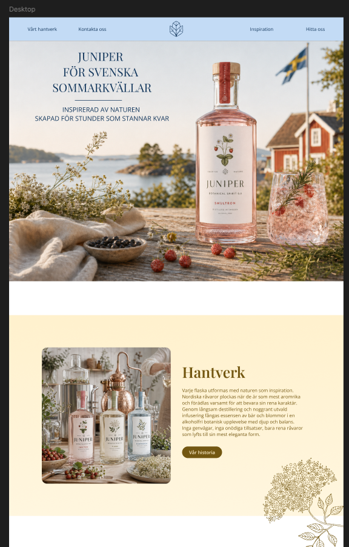
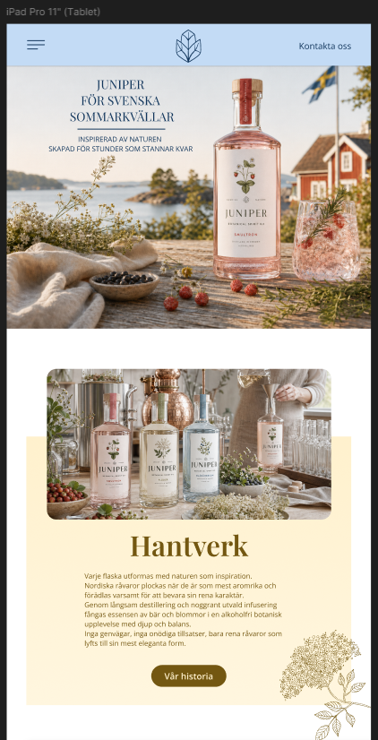
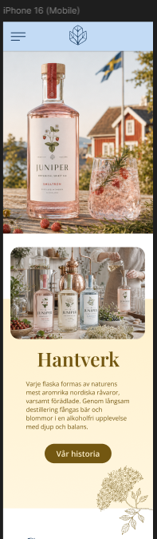
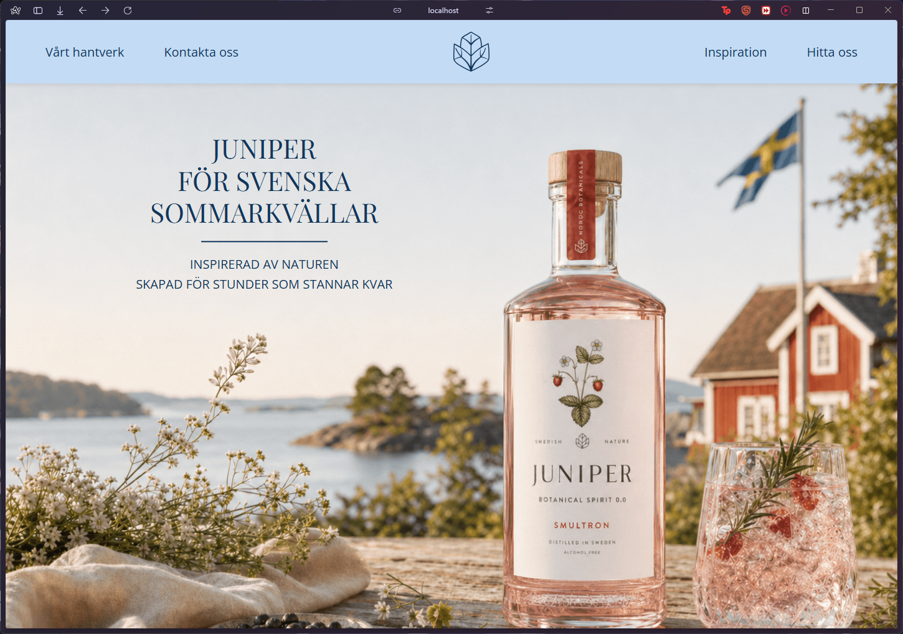
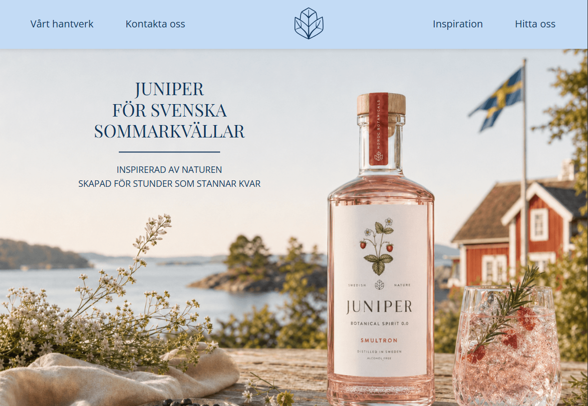
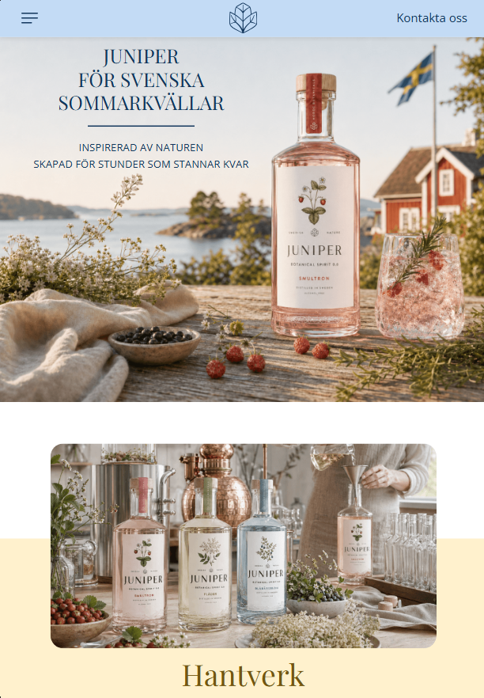
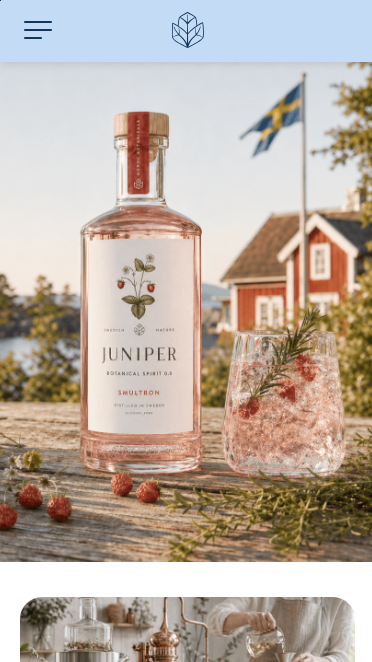

[](https://classroom.github.com/a/j3SJFt0N)

# Juniper AB – Webbplats

> Gruppuppgift inom kursen Grafiska verktyg / Frontend-utveckling.  
> Grupp **Bledd & Trim** har implementerat en webbdesign skapad av gruppen **Vector Graphics**.

---

## Innehåll

- [Om projektet](#om-projektet)
- [Design](#design)
- [Skärmdumpar](#skärmdumpar)
- [Tech stack](#tech-stack)
- [Kom igång](#kom-igång)
- [Projektstruktur](#projektstruktur)
- [Responsivitet](#responsivitet)
- [Gruppen](#gruppen)

---

## Om projektet

Juniper AB är ett fiktivt svenskt företag som tillverkar alkoholfria botaniska drycker inspirerade av nordisk natur. Uppgiften bestod i att ta emot en färdig Figma-design från en annan grupp och implementera den som en fungerande, responsiv webbplats.

---

## Design

Designen togs fram av gruppen **Vector Graphics** i Figma och täcker tre breakpoints: desktop, surfplatta och mobil.

### Figma-design

| Desktop                                  | Surfplatta                             | Mobil                                  |
| ---------------------------------------- | -------------------------------------- | -------------------------------------- |
|  |  |  |

---

## Skärmdumpar

Implementerad webbplats:

| Desktop (1440px)                        | iPad liggande (1180px)                                | iPad stående (820px)                                | Mobil (375px)                        |
| --------------------------------------- | ----------------------------------------------------- | --------------------------------------------------- | ------------------------------------ |
|  |  |  |  |

---

## Tech stack

| Teknik                      | Användning                                                                                      |
| --------------------------- | ----------------------------------------------------------------------------------------------- |
| **HTML5**                   | Semantisk markup, tillgänglighet (ARIA)                                                         |
| **SCSS / Sass**             | Modulär styling med partials (`_header.scss`, `_inspiration.scss` m.fl.), variabler och nesting |
| **JavaScript (ES Modules)** | Hamburger-meny, cookie-banner, Swiper-initiering                                                |
| **Vite**                    | Byggverktyg och dev-server                                                                      |
| **Swiper.js**               | Touch-slider för produktsektionen                                                               |
| **Google Fonts**            | Playfair Display (rubriker) + Open Sans (brödtext)                                              |
| **Git / GitHub**            | Versionshantering och samarbete                                                                 |

---

## Kom igång

### Förutsättningar

- [Node.js](https://nodejs.org/) v18 eller senare
- npm

### Installation

```bash
# Klona repot
git clone https://github.com/Medieinstitutet/fed25d-grafiska-verktyg-vector-graphics.git
cd REPO-NAMN

# Installera beroenden
npm install

# Starta dev-server
npm run dev
```

Öppna `http://localhost:5173` i webbläsaren.

### Bygg för produktion

```bash
npm run build
```

Resultatet hamnar i `dist/`.

---

## Projektstruktur

```
├── src/
│   ├── css/
│   │   ├── main.scss           # Importerar alla partials
│   │   ├── _variables.scss     # Färger och CSS-variabler
│   │   ├── _spacing.scss       # Spacing-tokens
│   │   ├── _typography.scss    # Typografi
│   │   ├── _layout.scss        # Grundlayout
│   │   ├── _header.scss        # Header & navigation
│   │   ├── _hero.scss          # Hero-sektion
│   │   ├── _craft.scss         # Hantverk-sektion
│   │   ├── _products.scss      # Produkter / Swiper
│   │   ├── _inspiration.scss   # Hitta inspiration
│   │   ├── _find-us.scss       # Hitta oss / butikslogotyper
│   │   ├── _newsletter.scss    # Nyhetsbrev
│   │   ├── _footer.scss        # Footer
│   │   ├── _cookies.scss       # Cookie-banner
│   │   ├── _buttons.scss       # Knappstilar
│   │   └── _responsive.scss    # Globala responsiva regler
│   └── js/
│       ├── main.js             # JavaScript
│       ├── cookies.js          # Cookie-banner och samtyckeshantering
│       └── photo-carousel.js    # Bildkarusell/fotogalleri
├── img/
│   ├── png/                    # Produktbilder och fotografier
│   └── svg/                    # Logotyper och illustrationer
├── docs/                       # Skärmdumpar (läggs till manuellt)
├── index.html
├── favicon.ico
├── vite.config.js
└── package.json
```

---

## Responsivitet

Webbplatsen är testad och anpassad för följande breakpoints:

| Breakpoint    | Bredd           |
| ------------- | --------------- |
| Mobil         | ≤ 768px         |
| iPad stående  | 769px – 1024px  |
| iPad liggande | 1025px – 1280px |
| Desktop       | ≥ 1281px        |

Responsiviteten hanteras per komponent i respektive SCSS-partial med `clamp()` för fluid typografi och procentbaserade grid-layouter.

---

## Gruppen

| **Bledd & Trim**
| -------------------------------------------------------
| [Elena Holmberg](https://github.com/elenaholmberg)
| [Jenny Gustafsson](https://github.com/jennygustafsson)
| [Minai Karlsson](https://github.com/minza-42)
| [Rasmus Fransson](https://github.com/RasmusFranssonHub)

---

_Design av gruppen **Vector Graphics**. Implementering av gruppen **Bledd & Trim**._
